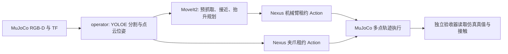

# MuJoCo Planned 模式视觉抓取设计

当前演示默认使用 `scene-1793463913737` 和 `grasp_cylinder.yaml`，以 `green cylinder` 检测地面横放圆柱 `cylinder-1`。圆柱按视觉估计的长轴、已知长度和半径加入 MoveIt 场景。下面的桌面盒体方案与示例对应保留的 `grasp_demo` / `grasp.yaml`；圆柱场景的检测和可达性需单独验收。

准备执行的轨迹及被拒绝的不完整笛卡尔轨迹记录在 `~/.cache/embodied-nexus/trajectories/`，并发布到 `/embodied_nexus/operators/grasp/planned_trajectory`，类型为 `trajectory_msgs/msg/JointTrajectory`。Web RViz 依据机器人模型绘制 `grasp_frame` 末端轨迹线。该预览是规划结果，实际执行状态仍以设备反馈为准。

每个抓取 Action 另生成 `~/.cache/embodied-nexus/logs/grasp-runs/<action_goal_id>.jsonl` 运行日志，记录任务输入、阶段切换、笛卡尔规划比例与速度缩放、轨迹摘要、设备执行请求和最终结果。HTTP 服务日志将 HTTP `task_id` 与 ROS `action_goal_id` 关联。机械臂执行日志记录轨迹摘要、稀疏 waypoint 进度及失败时的仿真/墙钟耗时、末点逐关节位置误差和关节速度。MuJoCo 在 `/sim/arachne/mujoco/arm_diagnostics` 发布关节目标/实测值、执行器力与限幅状态以及当前接触对；operator 在机械臂轨迹失败事件中附上最近快照及控制目标匹配轨迹终点时的最后快照，以区分停止前后的状态。笛卡尔接近、预抓取及抬升共用 `moveit_velocity_scaling` 和 `moveit_acceleration_scaling` 配置。

轨迹执行期间，任务 JSONL 每约 2 秒记录 `arm_trajectory_progress`，包含 Nexus 路点误差和最近的 MuJoCo 诊断快照；快照为 `null` 表示当时尚未收到诊断消息，`age_sec` 表示已收到快照的年龄。MuJoCo 日志记录每条机械臂轨迹的接收序号、时间、起终点、是否覆盖仍在执行的轨迹，以及目标发送结束时的实际关节位置。Nexus 进度日志记录关节反馈时间、位置、速度和反馈年龄；其最终日志包含成功、取消或失败状态。MuJoCo 的 `targets_finished` 表示轨迹目标已发送完毕，实际到位仍以 Nexus 的关节误差检查为准。通过 `grasp_test.sh` 启动时，MuJoCo 与 Nexus 日志位于 `~/.local/state/embodied-nexus/sim-mujoco-managed.log`，operator 日志位置由 `~/.local/state/embodied-nexus/grasp-test/operator.logpath` 指向。

## 目标和范围

首版在 MuJoCo 中抓取静止桌面目标。流程使用停稳后的公开 RGB-D 帧，YOLOE 文本提示分割目标，再用点云、相机内参和同一帧时间戳的 TF 测量目标尺寸及位姿；MoveIt2 只负责规划，所有机械臂和夹爪动作都经 Nexus 设备接口和控制租约执行。实机轨迹 Action 当前明确拒绝，不以仿真结果代替实机支持。



## 模块边界

`src/operator/` 下有三个独立 ROS 包：

- `embodied_nexus_operator_interfaces`：`PlanGrasp.action` 公共触发和反馈接口。
- `embodied_nexus_operator`：感知、抓取位姿计算、状态机、Action 服务、HTTP 入口、YOLOE 资产准备和验收器。
- `embodied_nexus_operator_moveit_config`：Arachne SRDF、运动学、OMPL 和 `move_group` 启动配置。

operator 通过相机公开话题、TF、机械臂/夹爪公开服务与 Action、MoveIt2 公开接口工作。MoveIt 返回的关节轨迹交给机械臂设备 Action；operator 不向 MuJoCo 控制话题直接发运动命令。设备节点继续持有控制租约、运动使能、停止和执行反馈语义。

仿真真值仅发布到 `/sim/arachne/ground_truth/scene_objects` 和 `/sim/arachne/gripper/contact_state`，用于夹爪反馈和独立验收。YOLOE、点云位姿估计和 MoveIt 场景不得订阅或读取这些真值话题。规划场景仅加入视觉估计的目标、固定桌面和配置中显式列出的已知障碍。

## 单次抓取状态机

1. **观察**：校验设备 backend 为 `ros2_sim`；申请机械臂和夹爪租约并续租；请求停稳，等待新鲜且时间戳匹配的 RGB-D 帧。
2. **观察与检测**：持有 Nexus 设备租约后，MoveIt2 先规划到配置的腕部相机观察关节位姿；机械臂停稳后采集时间匹配的 RGB-D。YOLOE `YOLOE-11s-seg` 使用预先缓存的 `red rectangular box` 文本提示，选取置信度最高的分割实例。运行时不下载模型或文本编码器。
3. **定位**：用深度相机内参反投影；通过时间戳匹配的 depth→color TF 将点投影到彩色掩码；保留掩码内点后转换到 `base_link`，过滤支撑面和离群点，用水平 PCA 和稳健范围估计尺寸、中心与朝向。
4. **规划与预抓取**：把已知桌面、可选静态障碍和视觉目标加入 MoveIt planning scene。规划 `grasp_frame` 到目标上方的预抓取位姿；轨迹通过带租约的 `/embodied_nexus/arms/<arm_id>/execute_trajectory` 执行。
5. **接近**：在只允许目标盒与两侧手指接触的规划条件下，计算笛卡尔接近段；要求 MoveIt 返回足够完整的路径，再经同一个机械臂 Action 执行。
6. **闭合**：夹爪动作通过 `/embodied_nexus/grippers/<gripper_id>/move` 提交。MuJoCo 默认以可调半尺寸盒体代替指尖网格碰撞，保留网格外观，并使用摩擦与真实接触；仿真后端将目标物体接触作为闭合阶段的停止信号。静止反馈本身不代表到位或抓取成功。
7. **抬升和结果**：目标加入 `grasp_frame` 的附着碰撞体后，规划并执行抬升。动作结果只表示流程完成且夹爪仍反馈目标接触；`grasp_verified` 保持 `false`，必须由独立验收器检查真值抬升。

机械臂 Action 的墙钟超时由规划轨迹时长乘以 `arm_trajectory_timeout_multiplier` 并加上 `arm_trajectory_timeout_margin_sec` 计算。这样本地渲染负载导致 MuJoCo 低于实时运行时，轨迹仍可按仿真时间完成并留出稳定等待；仿真暂停仍会被这个墙钟上限约束。

取消、租约续租失败、TF/图像缺失、点云不足、规划或执行错误均触发设备停止，释放租约并清理规划场景。每次只接受一个 operator 抓取任务。

## ROS 和 HTTP 触发

ROS 2 Action 为 `/embodied_nexus/operators/grasp`，类型 `embodied_nexus_operator_interfaces/action/PlanGrasp`。目标字段：`target_class`（默认 `red rectangular box`）、`object_id`（首版 `target_box`）、`camera_id`、`arm_id`、`gripper_id`。反馈报告状态阶段、说明和检测置信度；结果提供是否完成、是否经独立验收验证及估计物体/抓取位姿。

HTTP 服务默认仅监听 `127.0.0.1:8782`，认证密钥从 `EMBODIED_NEXUS_OPERATOR_HTTP_TOKEN` 读取。`POST /plan`（兼容入口 `POST /tasks`）创建同一个 ROS Action 任务；`GET /tasks/{task_id}` 查询；`DELETE /tasks/{task_id}` 取消。示例：

```bash
export EMBODIED_NEXUS_OPERATOR_HTTP_TOKEN="$(openssl rand -hex 32)"
curl -sS -X POST http://127.0.0.1:8782/plan \
  -H "Authorization: Bearer ${EMBODIED_NEXUS_OPERATOR_HTTP_TOKEN}" \
  -H 'Content-Type: application/json' \
  -d '{"target_class":"red rectangular box","object_id":"target_box","camera_id":"camera_front","arm_id":"arm_main","gripper_id":"gripper_main"}'
TASK_ID="replace-with-task-id-from-response"
curl -sS "http://127.0.0.1:8782/tasks/${TASK_ID}" \
  -H "Authorization: Bearer ${EMBODIED_NEXUS_OPERATOR_HTTP_TOKEN}"
curl -sS -X DELETE "http://127.0.0.1:8782/tasks/${TASK_ID}" \
  -H "Authorization: Bearer ${EMBODIED_NEXUS_OPERATOR_HTTP_TOKEN}"
```

监听地址可在 `config/grasp.yaml` 中调整。若改为局域网监听，应结合网络隔离和 token 管理部署；默认只接受本机请求。

## YOLOE 模型和依赖

### 当前 WSL 本机环境

最近一次绿色圆柱抓取复验记录在[2026-11-01 MuJoCo 验收记录](mujoco-acceptance-20261101.md)。

本机 MuJoCo 抓取运行在 WSL2 Ubuntu 22.04 / ROS 2 Humble，工作区映射为 `/mnt/d/code/project/EmbodiedNexus`，构建 overlay 为 `/home/dministrator/.cache/embodied-nexus/operator-install`。当前 Python 3.10.12 环境使用 NVIDIA RTX 3090、PyTorch `2.5.1+cu121` 和 Ultralytics `8.3.253`，CUDA 已验证可用。

ROS operator 通过系统 Python 启动；本机视觉包实际位于 `/mnt/d/enx-local-cache/operator-runtime-py310`，所以启动进程需要将该路径加到 `PYTHONPATH`。缺少这项环境变量时会出现 `No module named ultralytics`，这表示进程搜索路径配置遗漏，不代表本机依赖丢失。运行前加载 ROS 和 operator overlay，并设置 `YOLO_AUTOINSTALL=False`；常用命令见[MuJoCo 验收指南的本机环境记录](mujoco-acceptance.md#当前本机运行环境)。

YOLOE 权重、MobileCLIP TorchScript 编码器及绿色圆柱文本 embedding 已缓存于 `/home/dministrator/.cache/embodied-nexus/models/`。本地运行只读取这些文件，不需要网络访问或在线安装。`mobileclip_blt.ts` 只在重新生成文本 embedding 时使用，已有的 `yoloe-green-cylinder-text.npz` 可直接供抓取节点使用。清理本机缓存时保留模型目录、运行依赖目录和 operator overlay。

默认使用 Ultralytics 官方 `yoloe-11s-seg.pt`（YOLOE-11s segmentation）权重，来源 URL 和校验和写入本机 `yoloe-red-rectangular-box-text.manifest.json`。准备脚本通过 YOLOE 的文本编码器生成 `red rectangular box` prompt embedding，并将类别名与 tensor 保存到 `.npz`；运行节点用 `YOLOE.set_classes()` 加载缓存，运行时不需要 CLIP 文本编码器。脚本也记录实际安装的 Ultralytics、PyTorch、CUDA 状态和资产 SHA-256。权重、embedding 和文本编码器文件不提交到仓库。

Ultralytics 版本锁定为 `8.3.253`，与本模块使用的 YOLOE 接口一致：[YOLOE 模型说明](https://docs.ultralytics.com/models/yoloe)。资产来源固定为 [Ultralytics assets v8.3.0](https://github.com/ultralytics/assets/releases/tag/v8.3.0)。Ultralytics 代码按 AGPL-3.0 发布并提供企业许可选项；部署和分发前应依实际使用方式确认许可适用性：[Ultralytics 许可证](https://github.com/ultralytics/ultralytics)。

MoveIt 配置使用 Humble 的 `MoveItConfigsBuilder` 加载 Arachne Xacro、SRDF、运动学、关节限位和 OMPL 参数：[MoveIt Humble 配置构建器 API](https://moveit.picknik.ai/humble/api/html/moveit__configs__builder_8py_source.html)。

准备权重与 prompt embedding：

```bash
python3 -m pip install --user torch==2.5.1 torchvision==0.20.1 \
  --index-url https://download.pytorch.org/whl/cu121
python3 -m pip install -r src/operator/embodied_nexus_operator/requirements-vision.txt
python3 src/operator/embodied_nexus_operator/scripts/prepare_yoloe.py
```

依赖面向 Ubuntu 22.04 / Python 3.10 / RTX 3090；PyTorch 使用 CUDA 12.1 wheel。首次准备需要联网，以获取 checkpoint、锁定版本的 CLIP 文本编码依赖和 MobileCLIP 文本编码器权重。模型目录固定为 `~/.cache/embodied-nexus/models/`；部署运行前可先通过 `preview_yoloe` 检查识别效果。此前针对 `3 × 3 × 10 cm` 直立盒体的本地 MuJoCo RGB 渲染测试使用 `0.10` 检测阈值得到有效掩码；平放验收盒体仍需单独复核检测预览。

## 关键参数和首版限制

桌面高度、预抓取/抬升距离、RGB-D 同步窗口和规划超时在 operator 场景配置中。目标尺寸每次从点云测量，不再读取固定尺寸；`target_shape: cylinder` 对横放圆柱用支撑面至顶面的高度估计直径，其他目标使用可见点包围盒。掩码接触图像边缘、深度不足及异常尺寸会终止任务；夹爪宽度只检查从 URDF 网格计算的保守几何上限，不是实测净开口。单视角会低估被遮挡的尺寸，无法识别所有遮挡，不能保证通用抓取。YOLOE 仍使用配置的本地文本提示与缓存 embedding，切换目标类别需准备相应本地 embedding。夹爪闭合轴按测得的水平长边旋转 90°；近似正方形使用配置的固定方向。

demo 场景验收盒体为平放的 `0.08 × 0.04 × 0.03 m`，短边朝向夹爪闭合轴；简化指尖碰撞盒默认半尺寸为 `[0.010, 0.045, 0.011] m`。MuJoCo 中实测原简化指尖接触盒中心相对 `grasp_frame` 沿工具 Z 轴负方向偏移约 `0.025 m`。demo 场景将简化碰撞盒沿各指关节局部 +Y 方向偏移 `0.015 m`，让有效夹持区域接近盒体中心，同时保持用于规划的原始指尖网格和桌面净空。末端直线接近允许至少 `90%` 的路径完成率；随后以 `1 cm` 实际末端位姿误差阈值复核，超差则尝试规划修正或中止。仿真反馈只在左右指都接触同一物体时报告目标接触；确认后将夹爪位置目标额外推进 `0.05 rad` 保持夹持。仿真闭合速度调低，使夹爪接触反馈有时间在盒体被推出前触发停止。demo 场景单独提高 MuJoCo Aubo 位置执行器的比例/微分增益，以减小承载时的关节静态偏差；未配置 `arm_position_actuator` 的其他场景保留原有增益。`grasp.yaml` 中的轨迹墙钟期限按本地渲染速度配置，仿真暂停仍受该期限限制。

仿真指尖碰撞参数可通过 demo launch 调整：`simplified_finger_collision:=false` 使用 URDF 网格碰撞；`finger_contact_box_half_size_m:="[0.020, 0.045, 0.011]"` 调整简化盒体半尺寸（米）。参数在 MuJoCo 模型编译时生效。

本机 WSL 环境和最新绿色圆柱抓取阶段结果记录在[2026-11-01 MuJoCo 复验记录](mujoco-acceptance-20261101.md)；早期构建与验收结果见[2026-10-31 历史记录](mujoco-acceptance-20261031.md)。源码实现或构建通过不能替代 YOLOE 检测、MoveIt 规划、接触和物体抬升验收。
