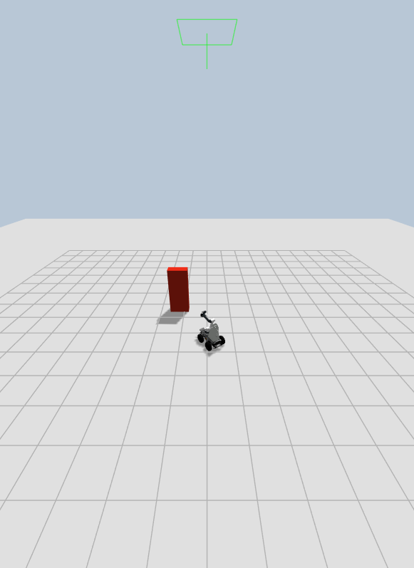

# Gazebo Fortress 仿真验收记录（2026-10-24）

## 环境与构建

- WSL2 Ubuntu 22.04、ROS 2 Humble、Gazebo Fortress 6.18.0；Windows Python 3.12 SDK 客户端访问 `http://127.0.0.1:8780`。
- Fortress 的传感器与 GUI 均选用 OGRE1；GUI 进程在 WSLg 下使用 `DISPLAY=:0`、`QT_QPA_PLATFORM=xcb`。Fortress 在本机 WSLg 默认 OGRE2 渲染路径会触发 `GL3PlusTextureGpu::copyTo` 崩溃；本包启动参数使用 `--render-engine ogre`，传感器系统也配置为 `ogre`。[Gazebo Fortress 渲染故障指南](https://gazebosim.org/docs/fortress/troubleshooting/)
- 模型来源固定为 Arachne 提交 `41caa564204eb5f6a39200ce2600ed052ab517b0`。仿真专用注入包含差速控制、RGB-D 和前后 180° 雷达；轮胎侧向摩擦采用上游模型记录的 `mu1=1.2`、`mu2=0.25`。
- `colcon list --base-paths src` 发现 17 个包。`colcon build --base-paths src --symlink-install --packages-up-to embodied_nexus_sim_gazebo` 通过。

## 自动测试

| 套件 | 结果 |
| --- | ---: |
| 底盘 | 22 通过 |
| 机械臂 | 17 通过 |
| 夹爪 | 16 通过 |
| 相机 | 18 通过 |
| 雷达 | 18 通过 |
| Core | 18 通过 |
| 通用仿真后端契约与时戳回退 | 5 通过 |
| Gazebo 资源、传感器转接与时钟守卫 | 6 通过 |
| Windows SDK | 9 通过 |

合计 129 项通过，无失败。本轮再次执行 WSL 设备与仿真测试套件及 Windows SDK 测试，结果一致。WSL 的 Starlette `TestClient` 输出 `httpx` 兼容性弃用警告，不影响测试结果。

## 本轮端到端复验

- Humble 重新构建发现的 17 个包，全部构建通过；设备与仿真单元测试 120 项、Windows Python 3.12 SDK 测试 9 项全部通过。
- 最新 `validate_sim.py` 运行中，五类设备独立启动、查询、关闭均成功。底盘里程计记录的 0.5 m 行程为 `0.48813 m`（误差 `0.01187 m`），30° 转向为 `0.52285 rad`（约 `29.96°`）；雷达在最近前向距离约 `1.178 m` 时取消底盘运动。随后机械臂/夹爪顺序协作、腕部相机 RGB-D、点云、LaserScan 和正常关闭均通过。
- 腕部相机在机械臂运动前后收到新帧（序号 `13` 与 `15`），两帧 SHA-256 分别以 `970f4a3f` 和 `72284184` 开头，确认观测图像发生变化。
- Gazebo GUI 的截图对比可见底盘由初始位置移动并转向；截图由 Gazebo 截图服务保存，避免了 Windows 桌面采集接口的权限错误。

底盘里程计与 Gazebo 场景真值的独立核对值见下文。截图：




## Windows SDK 与场景结果

使用 `examples/validate_sim.py` 通过 Windows SDK 走 Core / 设备服务 / ROS2 仿真后端。五类设备分别启动、查询和关闭成功；平台全启动后，底盘运动与避障、机械臂轨迹和速度命令、取消、夹爪开合及顺序协作均成功，随后全部服务正常关闭。

底盘真值由 Gazebo `/world/embodied_nexus_workcell/pose/info` 与设备里程计分别核对。独立干净场景测得 0.5 m 直行真值为 0.48898 m，误差 0.01102 m；30° 相对转向真值为 33.785°，误差 3.785°，均满足计划中的 0.05 m 和 5° 阈值。整套 SDK 流程中，0.5 m 动作反馈 0.481 m，30° 转向反馈 0.524 rad；雷达检测到前方障碍后取消底盘动作，停止阈值约 1.2 m，未发生碰撞。

机械臂执行小范围关节目标、位置步进速度控制、轨迹取消和返回；取消返回 `cancelled`，之后继续完成夹爪闭合、机械臂返回、夹爪打开。夹爪相对运动中止也返回 `cancelled`，且状态由仿真关节反馈产生。

传感器实测如下：

- RGB 为 `640×480 bgr8`，深度为 `640×480 16UC1`，深度比例 `0.001 m`；RGB 与深度共享 640×480 内参分辨率，焦距 `fx=fy=554.256 px`、主点 `(319.5, 239.5)`。SDK 采到的同步帧时间差不超过 0.1 s。
- 雷达 SDK 同时取得 `PointCloud2`（单帧 531 点，`lidar_link`）和 `LaserScan`（360 个角度样本，验收场景中 325 个有效距离）。
- WSL2 下相机实测速率受运行负载影响：单独采样约 6.7–8.6 FPS，最新五设备全链路验收时状态样本约 1.9 FPS，低于配置目标 10 FPS。RGB-D 点云有时会因帧时间差超过配置的 100 ms 阈值而跳过；这些是本机性能观察值，不代表目标运行设备吞吐量。

## 故障语义与运行范围

- 停止续租后，控制租约过期会撤销运动使能、发送零速并确认静止；速度命令超过 0.5 s 超时后，底盘同样回到零速并确认静止。
- 终止 Gazebo sensor bridge 后，新启动的相机保持 `offline`，雷达保持 `connected=false`、`data_fresh=false`；不会把缓存旧帧当作新反馈。
- `gui:=true` 已以 OGRE1 启动；运动前后截图已人工对比，确认底盘画面位置和朝向发生变化，见上方截图。
- Gazebo 暂停期间，活动底盘相对运动因里程计变旧而失败并请求停止；反馈过期时后端仍尝试发布零速。恢复仿真后旧操作仍为 `failed`，停止反馈确认静止，恢复后的额外里程计位移为 0 m。
- 通过 `WorldControl.reset.time_only` 回退仿真时钟时，Clock Guard 自动暂停世界，底盘活动操作返回 `failed` 并请求停止。手动解除暂停后守卫再次暂停；暂停状态之间的 Gazebo 场景真值位移为 `0.00003 m`、偏航变化小于 `1e-9 rad`。回退后的反馈停止确认保持未知，因此必须重启仿真 launch 才能恢复验收。
- 未启动真实机器人。仿真不模拟传感器噪声、真实夹爪传动标定、视觉定位、MoveIt 或完整抓取任务。

## 重现命令

在 WSL2 Ubuntu 22.04 中从仓库根目录启动：

```bash
source /opt/ros/humble/setup.bash
source install/setup.bash
export ROS_LOCALHOST_ONLY=1
export IGN_IP=<Windows 可访问的 WSL IPv4 地址>
ros2 launch embodied_nexus_sim_gazebo sim.launch.py gui:=false
```

Windows PowerShell 中运行 SDK 验收：

```powershell
$env:EMBODIED_NEXUS_CORE_URL = "http://127.0.0.1:8780"
$env:EMBODIED_NEXUS_CORE_TOKEN = "sim-local-token-change-me"
python src/sim/gazebo/embodied_nexus_sim_gazebo/examples/validate_sim.py
```
